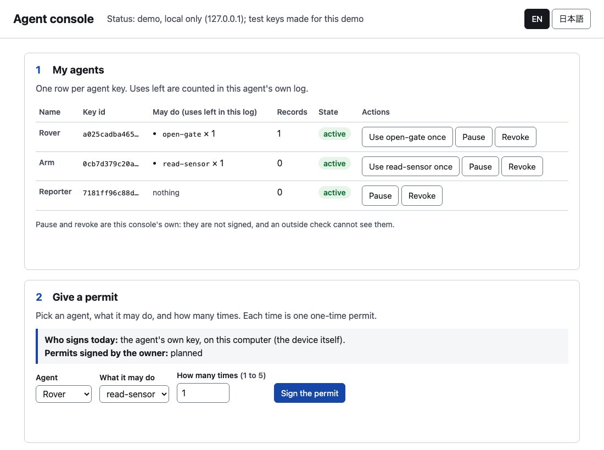
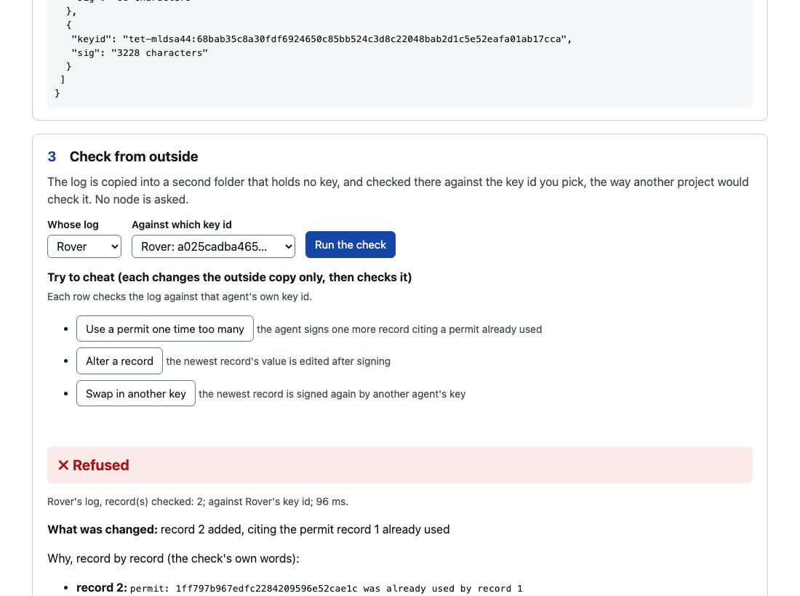

# Agent console

**Status: simulation, local only (127.0.0.1).** The agents are simulated, with test keys made for
this demo. Not the product page.

What verify relies on, beyond the folder: see "What verify relies on" in [the notebook README](../../../tools/machine-notebook/README.md).

One screen for agent keys and their checks, in plain words, with an EN | 日本語 switch:

1. **My agents**: one row per agent key: its name, a short key id, what it may do and how many uses
   are left in its log, and its state (active, paused, revoked).
2. **Give a permit**: pick an agent, what it may do and how many times. Each time is one one-time
   permit, signed by the agent's own key; the page shows the signed permit and its two-half envelope.
   It says who signs today (the device itself) and that permits signed by the owner are planned (設計中).
3. **Check from outside**: pick a log and a key id. The log is copied into a second folder that holds
   no key, and `notebook.py verify` runs there against that key id, the way another project would
   check it, with no node. Three "try to cheat" rows change the outside copy and are each refused.
4. **What this shows, and what it does not.**

Every agent is a machine notebook ([tools/machine-notebook](../../../tools/machine-notebook/README.md))
with a new key. Every signature and every log check goes through `notebook.py` and `tet-cli agent
sign|verify`; pause, revoke and the uses-left count are this console's own. The signatures and log checks are real tet-cli and notebook.py runs; the agents
themselves are simulated.



## Run it

Build tet-cli once from the repository (`cargo build -p tet-cli --release`), then, from an empty folder:

```sh
python3 <repo>/prep/demos/agent-console/console.py --work .
```

and open http://127.0.0.1:8766/. `TET_CLI=/path/to/tet-cli` points it at another build; `--port`
changes the port. Python 3 with its standard library is all it needs. It signs for a demo chain
(`tet-agent-console-demo`), not for a network, and contacts nothing.

It makes three agents (Rover, Arm, Reporter). Rover starts with two uses of `open-gate` and has used
one; Arm has one use of `read-sensor`. In the folder:

| Path | What it is |
|---|---|
| `device/<agent>/` | the agent's notebook: its key (`device.key`, mode 0600), records, permits |
| `pins/<agent>.pin` | the agent's two key ids, copied out of its folder when it was made |
| `outside/<agent>/` | the outside checker's copy of that log: no key, no pin |
| `console.json` | names, and pause and revoke states: this console's own, not signed |

Bounds, shown on the page: 1 to 5 uses per grant; a permit may be used by the next 100 records of
that log; at most 200 records per agent in this demo.

## Permits, uses, pause and revoke

"How many times" gives that many one-time permits (`notebook.py permit`), each signed by the agent's
own key. "Use once" writes one record that cites one of them (`notebook.py record --permit`), which
refuses a used or run-out permit before it writes. "Uses left" counts the agent's permits that no
record has cited and that its next record may still cite.

Pause and revoke belong to this console: a paused agent's uses and grants are refused here, and
revoking destroys the agent's key file on this computer. The outside check judges the log against the
pinned key; it does not judge this console's pause or revoke states. That is on the page, under "does
not show".

## The three cheats

Each starts from a fresh copy of the log, changes the copy (never the agent's own folder), and checks
it against that agent's own key id.

| Row | What it does to the copy | What the check says |
|---|---|---|
| Use a permit one time too many | one more record citing a permit a record already used; the row judges the permit check alone | that record, and nothing else: `permit: <id> was already used by record N` |
| Alter a record | the newest record's value is edited after signing | that record: `signature: ... is not the N bytes this envelope signed` and `chain.txt: hash differs from the record` |
| Swap in another key | the newest record is signed again, by another agent's key; the row judges the key pin alone | that record: `key: signed by <other key>, not this device's <key>`, and no signature problem |

Checking a log against another agent's key id (no cheat) is refused the same way: `key: signed by ...`.



## What this does not show

The check's own "shows" list (notebook.py's) is about the log it is given; the page says so.

- When each record was written: the check judges the order of records in the log it is given; it does not judge when each record was written.
- That a reading or action really happened, or that the machine's clock was right.
- Which machine signed: the check judges which key signed each record; it does not judge which machine held that key.
- Use of a permit in another log: the permit check judges reuse of a permit within one log; it does not judge use of that permit in another log.
- Pause and revoke here are this console's own. The outside check cannot see them.
- That the log is complete at its end: not judged. A log produced by the key's holder: not judged; the check judges the log it is given against the pinned key.
- Today the agent's own key signs its permits. A permit signed by the owner is planned.
- Nothing here runs on a robot: the agents are folders on this computer.
- That the signature format is final: not judged.

## Tests

```sh
TET_CLI=target/release/tet-cli python3 prep/demos/agent-console/test_console.py   # 22 tests
TET_CLI=target/release/tet-cli bash prep/demos/agent-console/controls.sh            # negative controls
```

The tests make three agents with the real tools and check each cheat for the reason it is named for,
the grant and use counts, pause and revoke, the server's 127.0.0.1 and same-origin rules, and the page
(every control labelled, every string in Japanese, no money words). `controls.sh` replaces each
cheat's tamper line (marked `# control:<name>` in `console.py`) with `pass` in a copy, and runs that
cheat's test, which must fail on its own assertion; it exits 0 only if all three fail that way.

## Accessibility

Every select and input has a label (a test checks it), the order of keys follows the four parts top
to bottom, focus is drawn with a 3 px dark orange outline (7.3:1 on white), results are announced (`aria-live`), and the
language switch says which is on (`aria-pressed`). Every button that repeats across rows names its agent for screen readers. Text contrast, computed
from the CSS colours with the WCAG formula, is 5.8:1 or more; not measured with a contrast tool.

## The video

The videos are not in git (they would stay in its history for good); they are kept outside it and
fetched separately. The stills are committed.

`demo.webm` (61 s) and `stills/` (six pictures, 1100 px wide) were recorded with `record_video.mjs`:
a headless Chromium with a fresh profile, every request not to 127.0.0.1 refused. It uses a
playwright-core already on the machine and installs nothing:

```sh
PLAYWRIGHT_CORE=/path/to/node_modules/playwright-core TET_CLI=/path/to/tet-cli node prep/demos/agent-console/record_video.mjs
```
