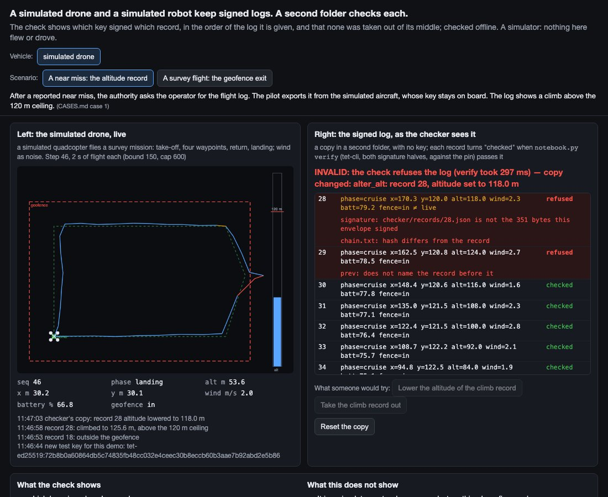
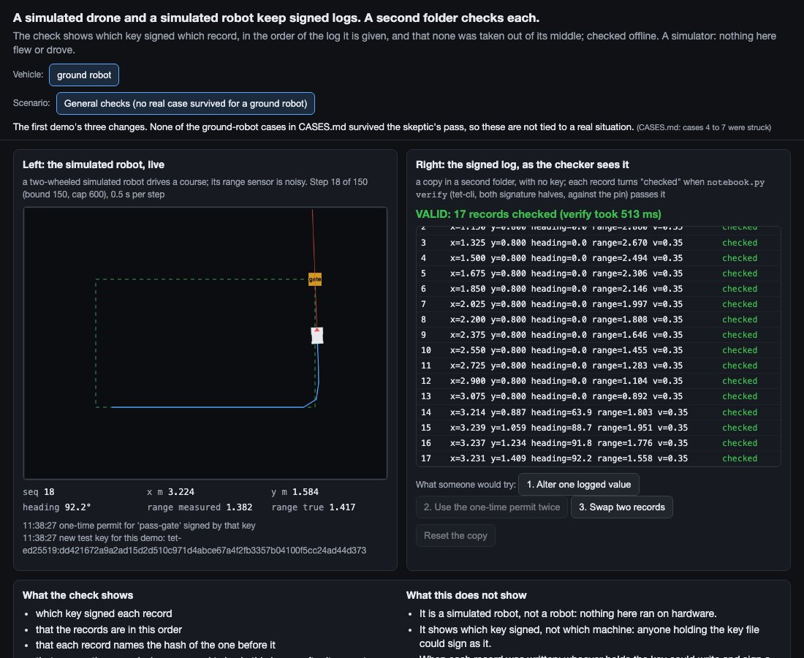
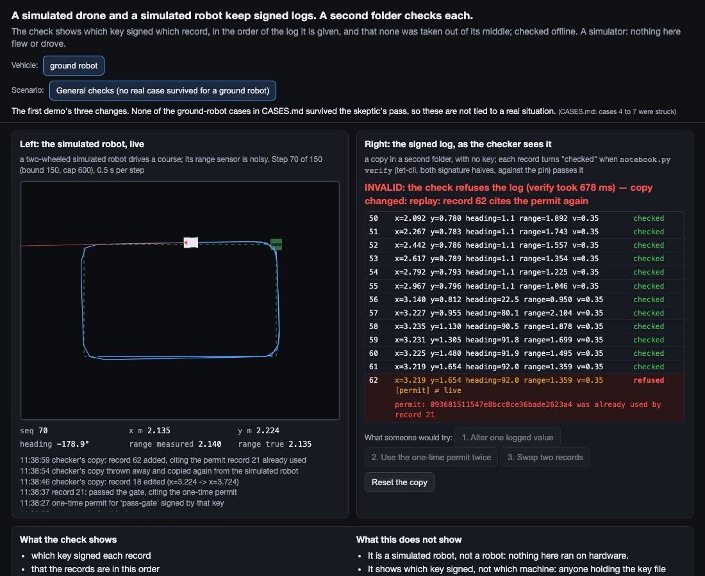
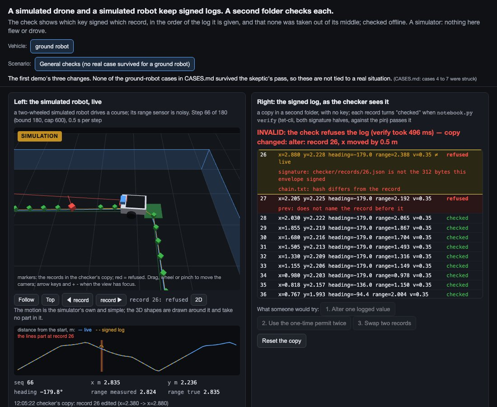
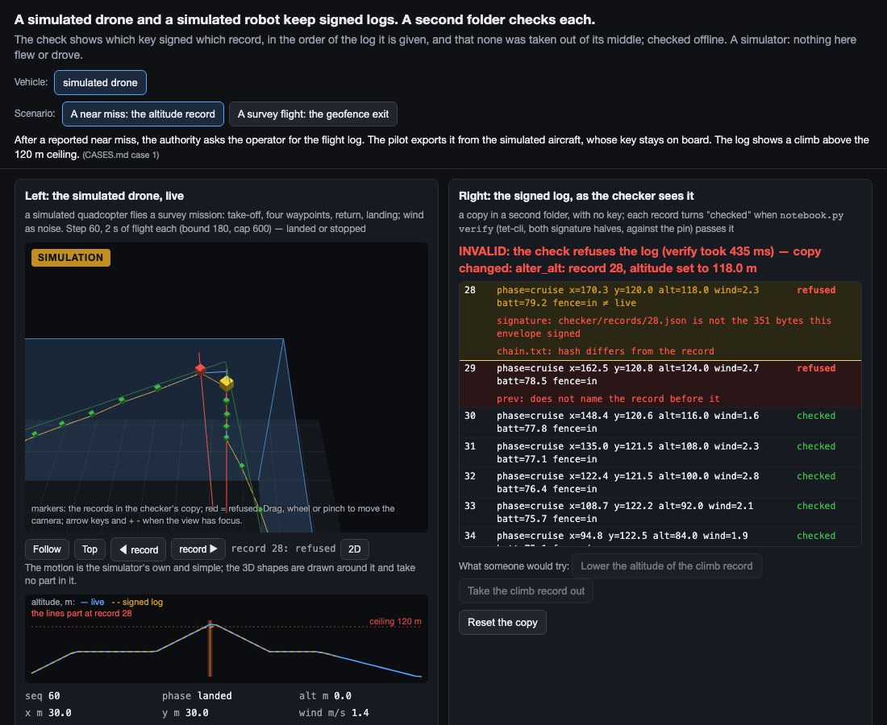

# Simulated machines, each with a signed log: a drone, a ground robot, a cold-chain box, a lab instrument

**Status: demo, local only (127.0.0.1).** A simulator: nothing here flew or drove, and no real logger, instrument or sensor was used.

What verify relies on, beyond the folder: see "What verify relies on" in [the notebook README](../../../tools/machine-notebook/README.md).

## The simulated drone

A simulated quadcopter flies a survey mission over a 200 m x 150 m area: take-off, four waypoints,
return, landing. Wind is a steady breeze plus noise, and one gust pushes it over the geofence for a
moment; one leg climbs above the 120 m ceiling set in the simulator. Each step is 2 s of simulated
flight and one signed record (`phase x y alt wind batt fence`). A flight is about 60 records.

The page has a vehicle switch (simulated drone | ground robot) and a scenario switch. The drone's two
scenarios are the two cases in [CASES.md](CASES.md) that were kept: of seven candidate
situations, five were dropped because an ordinary log or the result settles them, because they need
"which machine" or "the sensor told the truth", or because the person asked holds the key.

| Scenario | What someone would try (in the checker's copy) | What the check says |
|---|---|---|
| A near miss: the altitude record | lower the altitude of the climb record to 118 m | that record: `signature: ...` |
| | take the climb record out | the next record: `seq: file N+1.json where record N should be (a record is missing)` |
| A survey flight: the geofence exit | swap the exit record with the next one | both: `seq: says ..., is record ... in order` |
| | replace the exit record with one saying `fence=in`, signed by another key | that record: `key: signed by ..., not this device's ...`; the next record's `prev`; the log: `2 different keys signed this log` |



What this does not show, for every scenario:

- It is a simulator, not a drone or a robot: nothing here flew or drove.
- Which machine signed: the check judges which key signed each record; it does not judge which machine held that key.
- When each record was written: the check judges the order of records in the log it is given; it does not judge when each record was written.
- It does not show that the sensor or the GPS told the truth: the log holds what was measured.
- That the log is complete at its end: not judged.
- A log produced by the key's holder: the check judges the copy against the pinned key; it does not judge a log the key's holder produced.

and per scenario: that the barometer read the altitude right (near miss); that the geofence set in the
app was the boundary agreed with the client (geofence exit).

## Two machines that are not vehicles

[CASES-2.md](CASES-2.md) tested eight more situations by the same rule;
two survived. Each scenario carries a tag from [FUTURES.md](FUTURES.md): "today", or "about N years: a
forecast, not a fact". The page's machine switch has four entries; each scenario shows three boxes: why
TET fits it, what changes with a signed log, and how it differs from what exists (TET is one of many).

**A cold-chain box (tag: today).** A simulated refrigerated box on a 12 h road journey, depot to hub to
receiver, 15 minutes per record (`min temp door x y batt`, x and y in km on the route map). A second
carrier takes over at record 20, on paper; the logger does not log the leg. The door stays open for
records 18 and 19, and the box goes over 8 °C (peak at record 19), then recovers.

| What someone would try (in the checker's copy) | What the check says |
|---|---|
| lower the peak temperature to 7.80 °C | that record: `signature: ...`; the next record's `prev` |
| take the peak record out | the next record: `seq: file N+1.json where record N should be (a record is missing)` |
| swap the door-open record with the next one | both: `seq: says ..., is record ... in order` |

**A plate reader (tag: about 10 years: a forecast, not a fact).** A simulated plate reader reads one
culture well's optical density every 5 minutes for 2 hours (`min od600 temp`); logistic growth with
noise, and one high reading at record 11 from a simulated bubble (the bubble is not logged). It does not
move, so Fig. 1 draws its run along a time axis (one unit = 10 minutes) and the machine as a plain box.

| What someone would try (in the checker's copy) | What the check says |
|---|---|
| take the outlier reading out | the next record: `seq: file N+1.json where record N should be (a record is missing)` |
| edit the outlier to the mean of its neighbours | that record: `signature: ...` |

In both, the record changed or taken out has records after it. The check judges the records in the
copy and the order they were signed in; it does not judge whether the copy is complete at its end.
Each scenario's "does not show" list says so; so do the limits of each case (probe placement, and the
order of records but not their time, for the box; whether other runs were made, for the lab).

Videos (60 s each) and stills of these two are kept outside the repository, with the other recordings.

## The ground robot

No ground-robot case was kept, so the ground robot has three changes, labelled on the page as not tied to a real case.

A two-wheeled simulated robot drives a course in a 4 m x 3 m arena. Its range sensor is noisy. Every
step is written as one record into a machine notebook ([tools/machine-notebook](../../../tools/machine-notebook/README.md)),
signed by `tet-cli agent sign` with both signature halves (Ed25519 and ML-DSA-44), under a new key made
for this demo. A checker copies the log into a second folder that holds no key, and runs
`notebook.py verify` there against the pin kept outside both folders. Nothing in the demo signs or
checks by itself: every signature and every signature check goes through `notebook.py` and
`tet-cli`; the page's "≠ live" mark is a comparison the page makes itself.

The page has two panes. Left: the simulated robot in a 3D view, live, with its telemetry. Right: the
log as the checker sees it; each record turns "checked" when verify passes it, and a logged value that
differs from the live one is marked.

The sentence it shows: the check shows which key signed which record, in the order of the log it is
given, and that a one-time permission was not used twice in that log; checked offline.



## Run it

Build tet-cli once from the repository (`cargo build -p tet-cli --release`), then, from an empty folder:

```sh
python3 <repo>/prep/demos/robot-sim/robotsim.py --work .
```

It runs both vehicles by default; `--vehicles drone` or `--vehicles robot` runs one, which keeps each
check fast (with both running, a check of 35 records took 5.5 s on a laptop).

and open http://127.0.0.1:8765/. `TET_CLI=/path/to/tet-cli` points it at another build. Python 3 with
its standard library is all it needs. For each vehicle the demo makes `<vehicle>/device/` (its notebook
and key, mode 0600), `<vehicle>/checker/` (the copy, no key) and `<vehicle>/device.pin` in that folder;
the drone's other-key button makes `drone/other/`, a second notebook with another key. It signs for a demo
chain (`tet-robot-sim-demo`), not for a network, and contacts nothing.

Options: `--port` (default 8765), `--step` seconds per step (0.05 to 10, default 0.5), `--max-steps`
(default 120). Each vehicle stops after `--max-steps` (the drone earlier, when it lands); the cap is
600, and the page shows both.
Verify reads the whole log every time a record arrives; on a laptop that took 815 ms at 117 records.

## The ground robot's three buttons

Each changes the checker's copy only, never the simulated robot's own folder. "Reset the copy" throws
the copy away and copies the log again.

| Button | What it does to the copy | What the check says |
|---|---|---|
| 1. Alter one logged value | moves `x` of one record by 0.5 m | that record: `signature: ... is not the N bytes this envelope signed` and `chain.txt: hash differs from the record`; the next record's `prev` no longer names it |
| 2. Use the one-time permit twice | adds a record that cites the permit already used; the case judges the permit check alone | that record, and nothing else: `permit: <id> was already used by record N` |
| 3. Swap two records | two records trade places, each with its own valid signature | both: `seq: says N+1, is record N in order`, and their `prev`; the record after them: its `prev`; no signature problem |



## The 3D view

The left pane draws the vehicle in 3D. For the simulated drone: the 200 m x 150 m area, the planned
route, the geofence as translucent walls up to the 120 m ceiling, a quadcopter with spinning rotors,
its shadow and a line down to the ground, and the path it flew. For the ground robot: the arena, the
course, the arena wall as a translucent wall, a body on two wheels with its range ray, and the path it
drove. Each record in the checker's copy is
a marker on that path, at the place the record says; a marker turns red when the check refuses its
record. Clicking a line of the log (or Enter on it) moves the camera to its marker; "record" steps
through them from the keyboard. "Follow" keeps the camera on the vehicle, "Top" looks straight down;
drag to turn, wheel or pinch to zoom, arrow keys and + and - on the focused view.

Under it, a strip draws one quantity twice: from the live simulation (solid) and from the signed log in
the checker's copy (dashed). For the robot it is the distance from the start; for a drone, the
altitude. A copy changed in this quantity makes the two lines part at the records it touched, and the strip names them.



What it draws, and from where:
- the vehicle, its path and its range ray: the simulation's telemetry (`/state` `live`);
- the markers, their colour and the strip's dashed line: only the records the checker read in its
  copy (`/state` `check.records`). `logView()` in view3d.js reads nothing else of the state but the
  vehicle kind and the course's start point (for the distance), and the tests fail if
  a marker or the dashed line moves when the live telemetry does.

It is honest about what it is: the "SIMULATION" banner is always on screen; the motion is the
simulator's own (for the robot: a point with a heading, constant speed 0.35 m/s, no inertia, no wheel
slip; about 60 lines in `Sim`; for the drone: a point that flies toward each waypoint at up to 8 m/s
and climbs at up to 4 m/s, drifted by the wind and one gust, no inertia, in `DroneSim`), and the 3D shapes are drawn around that
point and take no part in it. The drone reports no heading; the model faces the way it last moved.



The view is one file written for this demo, `view3d.js` (550 lines: a WebGL renderer for boxes,
cylinders, lines and one light, the two models, the camera, the 2D fallback and the strip);
there is no library, and the page loads nothing but itself: the server inlines `view3d.js` into the
page. Without WebGL (no GPU, or a browser that refuses it) the page draws a 2D top view instead, and
the "2D" button switches to it at any time; `?view=2d` starts there. On a narrow screen the panes
stack. The strip judges one quantity only; it does not judge a change that leaves that quantity
alone (the marker still turns red).

## What this does not show

- It is a simulated robot, not a robot: nothing here ran on hardware.
- Which machine signed: the check judges which key signed each record; it does not judge which machine held that key.
- When each record was written: the check judges the order of records in the log it is given; it does not judge when each record was written.
- It does not show that the sensor told the truth: the log holds what was measured, noise and all.
- Use of a permit in another log: the permit check judges reuse of a permit within one log; it does not judge use of that permit in another log.
- That the log is complete at its end: not judged. A log produced by the key's holder: not judged; the check judges the log it is given against the pinned key.
- Who signed a permit as owner: not judged; the permit is signed by the machine's own key.
- Names in a log folder handed to the encounter or PX4 checker: only lower-case ASCII letters, digits, "_", "." and "-"; a folder holding any other name: refused.

The notebook's own list (the clock, the place, who runs the machine, whether the signature format is
final: all not judged) applies too; see its README.

## Tests

```sh
TET_CLI=target/release/tet-cli python3 prep/demos/robot-sim/test_robotsim.py   # 26 tests
TET_CLI=target/release/tet-cli bash prep/demos/robot-sim/controls.sh            # negative controls
node prep/demos/robot-sim/test_view3d.mjs                                       # the 3D view: 10 tests
TET_CLI=target/release/tet-cli bash prep/demos/robot-sim/controls_view.sh       # its negative controls
```

`test_view3d.mjs` gives the view states shaped like `/state`; `test_robotsim.py` (class `View`) gives
it a real one, signed and checked with tet-cli, with one value altered in the copy. `controls_view.sh`
makes the view read the live value for each record instead of the record (both suites must fail),
and makes it claim WebGL when there is none (the fallback test must fail).

The test builds a 6-step robot log and a drone flight up to the record after its climb (about 30
records) with the real tools, and checks each button for the reason it is named for. `controls.sh`
replaces each button's tamper line (marked `# control:<name>` in `robotsim.py`) with `pass` in a copy,
and runs that button's test, which must fail on its own assertion; it exits 0 only if all thirteen fail
that way.

## The video

The videos are not in git (they would stay in its history for good); they are kept outside it and
fetched separately. The stills are committed.

`demo-drone.webm` and `demo-robot.webm` (about 90 s each) and `stills/` (six pictures per vehicle,
1100 px wide) were recorded with `record_video.mjs` (`VEHICLE=drone` or `robot`): a headless Chromium with a fresh profile, every request not to 127.0.0.1 refused.
It uses a playwright-core already on the machine and installs nothing:

```sh
PLAYWRIGHT_CORE=/path/to/node_modules/playwright-core VEHICLE=drone node prep/demos/robot-sim/record_video.mjs
```

`demo-3d-drone.webm` and `demo-3d-robot.webm` (90 s each) and `stills/3d-drone-*.jpg` and
`stills/3d-robot-*.jpg` (six each, 1100 px wide) show the 3D view. They were recorded the same way with
`record_3d.mjs drone` and `record_3d.mjs robot` (headless Chromium draws WebGL in software, so no GPU
is needed). `demo-drone.webm`, `demo-robot.webm` and the other stills were recorded before the 3D view
and show the earlier 2D drawing.

Real robot simulators that would make this more convincing are compared in [SIMULATORS.md](SIMULATORS.md);
none is used here.
