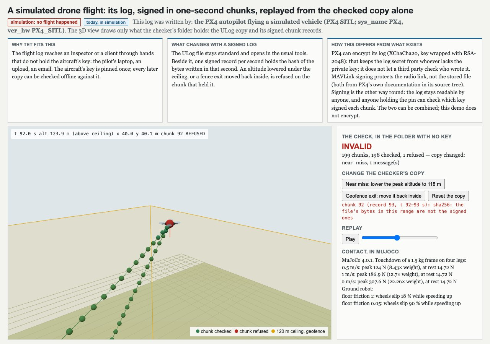
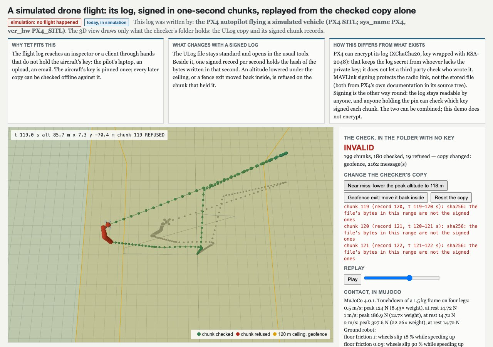

# A drone's ULog, written by PX4 in simulation, signed in chunks, checked and replayed in 3D from the copy alone

**Status: demo, local only (127.0.0.1). Simulation: no flight happened.**

What verify relies on, beyond the folder: see "What verify relies on" in [the notebook README](../../../../tools/machine-notebook/README.md).

**This log was written by the PX4 autopilot flying a simulated vehicle.** PX4 SITL (commit
f65fe36aea04, target `px4_sitl_sih`, its built-in SIH quadcopter simulator) ran on a Mac with its
MAVLink sockets bound to 127.0.0.1. `fly_px4.py` uploaded a mission over MAVLink, armed it and put it
in mission mode; PX4 flew it, landed and disarmed by itself, and its logger wrote the ULog
(`sys_name` PX4, `ver_hw` PX4_SITL). That file, unchanged, is what is signed, checked and replayed
here. It is about 45 MB and is not committed; `demo.py --ulog` takes it. A 261 KB excerpt of it is
committed (`fixtures/px4-sitl-excerpt.ulg`, see Tests), so the tests on a log PX4 wrote run in CI. Without `--ulog` the demo
falls back to `flight.py`, a stand-in that writes a ULog in PX4's layout but is **not** PX4's, and the
page then says "not PX4".

## The PX4 run (2026-11-19)

```sh
cd $SIM_ENGINES/px4/PX4-Autopilot/build/px4_sitl_sih
PX4_SIM_MODEL=sihsim_quadx PX4_SIMULATOR=sihsim PX4_NET_INTERFACE=lo ./bin/px4 -d -i 1 -w WORKDIR "$PWD/etc"
$SIM_ENGINES/px4/venv/bin/python prep/demos/robot-sim/px4/fly_px4.py --listen 127.0.0.1:14541 --sysid 2 --out mission.json
./bin/px4-shutdown --instance 1
```

`PX4_NET_INTERFACE=lo` is what makes PX4 bind its MAVLink sockets to 127.0.0.1 (in
`mavlink_main.cpp`); without it they bind to every interface.

| | |
|---|---|
| mission (metres from home, x north, y east) | take-off to 30 m; (40, 0) at 60 m; (40, 40) at 124 m; (0, -95) at 80 m; (0, -40) at 40 m; return and land; 8 m/s |
| PX4 said | mission accepted (7 items), armed, mission mode; items 1, 2, 3, 4 and 6 reported reached (the script saw no report for 0 and 5); landing detected, disarmed by landing; 183.8 s from heartbeat to disarm |
| MAVLink `LOCAL_POSITION_NED` during the flight | peak altitude 124.1 m; furthest west y = -94.1 m |
| the ULog PX4 wrote | 45,629,776 bytes, 520,865 messages, 157 formats; 24,786 `vehicle_local_position` samples (about 100 Hz) |
| signed | 199 chunks |
| near miss (peak lowered to 118 m) | refused on exactly one chunk, for the hash reason only |
| geofence exit (2,162 samples moved 1 m inside) | refused on exactly the 19 chunks that held them, each for that reason |

The ceiling (120 m) and the fence (y < -75 m) are this demo's lines, checked against the log
afterwards. PX4's own geofence was not set for this flight, so PX4 did not react to them; the mission
flies past both on purpose. The chunks were signed **after** the flight, on the same machine, by the
notebook tool: signing inside PX4 while it flies is not built.

## What it does

1. **Fly.** PX4 flies `fly_px4.py`'s mission (above). Without PX4, `flight.py` flies a survey mission over a 200 m x 150 m area with the two cases kept in
   [../CASES.md](../CASES.md): one leg climbs to 123.4 m, above the 120 m ceiling (the near miss),
   and a gust pushes the vehicle past the west fence for 10.5 s (the geofence exit). It writes
   `vehicle_local_position`, `vehicle_attitude` and `vehicle_status` at 10 Hz, PX4's topic names,
   with PX4's NED frame.
2. **Sign in chunks.** `ulogsign.py sign` cuts the file at ULog message boundaries, about one
   second of log time per chunk (chunk 0 also holds the header and definitions), and writes one
   notebook record per chunk: `ulog-chunk <i> off=<byte> len=<bytes> t0=<us> t1=<us> sha256=<hex>`.
   Each record goes through the real notebook tool, `tools/machine-notebook/notebook.py record
   --source stdin-json`, which signs with `tet-cli agent sign` (Ed25519 and ML-DSA-44). The ULog
   file itself is not changed and opens in the usual tools.
3. **Check.** A second folder, with no key, gets a copy of the records (`checker/log/`: `chain.json`,
   `chain.txt`, `records/`), and a copy of the ULog file beside it (`checker/flight.ulg`), not inside it.
   A folder holding a file over 1 MiB is refused whole, so the ULog stays outside the folder given with
   `--dir`. `ulogsign.py check` runs `notebook.py verify` on that folder against the pin kept outside
   both folders, then hashes each chunk's byte range of the ULog copy. A ULog over 1073741824 bytes
   (`ULOG_MAX_BYTES`, 1 GiB) is not read past that bound: the verdict is ERROR, with that number named.
   A chunk is "checked" only when its record passes verify and its bytes hash to the signed value. Bytes past the last signed chunk are named.
4. **Replay.** The page (`replay.html`, on the vendored three.js) draws the flight read from the
   checker's copy alone: the vehicle model, shadows, the trail coloured by its chunk's verdict, one
   marker per chunk, the ceiling and the geofence. A sample is drawn as checked only when its own
   chunk and every chunk holding a format or subscription message are checked, because those decide
   how its bytes are read. Its two buttons make the two tampers in the
   checker's copy and check again.

| Case (stand-in log) | What someone would try (in the checker's copy) | What the check says |
|---|---|---|
| near miss | lower the highest altitude sample to 118 m | that chunk only: `sha256: the file's bytes in this range are not the signed ones` |
| geofence exit | move every sample outside the fence to 1 m inside it (105 messages) | exactly the 11 chunks that held them, each for that reason |

PX4's log, the near miss (one chunk refused) and the geofence exit moved inside (19 chunks refused):





The stand-in's stills are `media/px4-[1-6]-*.jpg`; PX4's are `media/px4-real-[1-6]-*.jpg`. The 90 s
videos (the stand-in's and PX4's, 8 to 9 MB each) are kept outside git and fetched separately;
`record.mjs` makes them (with `PX4DEMO_ULOG` for PX4's log).

## Signing is not PX4's log encryption

PX4 can encrypt its log (docs/en/dev_log/log_encryption.md in PX4-Autopilot: XChaCha20, with the
symmetric key wrapped by an RSA-2048 public key, in a `.ulge` file). That keeps the log **secret**:
only the holder of the RSA private key can read it. It says nothing to a third party about **who
wrote** the log or whether it was changed: encryption judges who can read the log, not who wrote it.
Chunk signing is the opposite: the log stays readable by anyone, and anyone holding the pin can
check, offline, that each chunk is the one the aircraft's key signed. The two can be combined; this
demo does not encrypt.

## What this does not show

- That anything flew: this is a simulation; no flight happened. PX4 flew a simulated vehicle.
- That PX4 signed the log: PX4 wrote it; the notebook tool signed it after the flight.
- That PX4 wrote the log, by any check: the page names PX4 from the log's own header (`sys_name`,
  `ver_hw`); the check judges that those bytes are the signed ones, and does not judge who wrote
  them. That PX4 wrote this one rests on the run above.
- That PX4 kept to the ceiling or the fence: they are the demo's lines; PX4's geofence was not set.
- Which machine signed: the check judges which key signed each chunk; it does not judge which
  machine or person held that key.
- That a sensor told the truth: the log holds what was measured (here, simulated).
- That the log is complete at its end: the check does not judge whether the last chunks are present
  (a test pins this scope).
- When a chunk was written: the check judges which key signed each chunk; it does not judge when the
  signing happened.
- The 3D page does not read the vehicle over MAVLink live: it replays the signed log only.

## Contact, in MuJoCo

`contact.py` uses MuJoCo 4.0.1 for contact only: a 1.5 kg frame on four legs touching down with
90 % of hover thrust until the first leg touches, and a two-wheeled robot speeding up on two
floors. Results of this run (the leg stiffness is a chosen parameter, `solref="0.02 1"`, not a
measurement of real legs; the peak force depends on it):

| | peak normal force | at rest | bounce |
|---|---|---|---|
| touchdown at 0.5 m/s | 124.0 N (8.43x weight) | 14.72 N (weight 14.72 N) | 0.0 cm |
| touchdown at 1.0 m/s | 186.9 N (12.7x) | 14.72 N | 0.1 cm |
| touchdown at 2.0 m/s | 327.6 N (22.26x) | 14.72 N | 0.2 cm |

Ground robot, wheels commanded to 8 rad/s: slip while speeding up 17.8 % on floor friction 1.0,
89.5 % on 0.05. Once steady, MuJoCo still shows 5.9 % on friction 1.0 (its soft contact lets the
wheels creep; not tuned) and 0 % on 0.05.

## Run it

```sh
TET_CLI=/path/to/tet-cli python3 prep/demos/robot-sim/px4/demo.py --work EMPTY_DIR
$SIM_ENGINES/mujoco/bin/python prep/demos/robot-sim/px4/contact.py --out EMPTY_DIR/contact.json   # optional
```

then open http://127.0.0.1:8766/. `--ulog FILE.ulg` signs a given ULog, e.g. the one PX4 wrote,
instead of flying `flight.py`. Signing PX4's log (199 chunks) and checking the copy took 14.8 s here;
each tamper and re-check about 2.7 s. The stand-in's 115 s flight is 116 chunks, 94049 bytes.

## Tests

```sh
TET_CLI=/path/to/tet-cli PX4_REAL_ULOG=PX4_LOG.ulg python3 prep/demos/robot-sim/px4/test_px4.py   # 52 tests
TET_CLI=/path/to/tet-cli PX4_REAL_ULOG=PX4_LOG.ulg python3 prep/demos/robot-sim/px4/controls.py    # negative controls, each must fail
$SIM_ENGINES/mujoco/bin/python prep/demos/robot-sim/px4/test_contact.py  # 4 tests
CONTACT_CONTROL=wheel_friction $SIM_ENGINES/mujoco/bin/python prep/demos/robot-sim/px4/test_contact.py Robot  # must fail
```

The signed-log checks run three times: on the stand-in (`SignedFlight`, everywhere, CI included); on a
committed excerpt of the log PX4 wrote (`SignedPX4Excerpt`, everywhere, CI included); and on the whole
45 MB log (`SignedPX4Flight`, only where `PX4_REAL_ULOG` names it). Without `PX4_REAL_ULOG` and
PX4's sample log, as in CI, 37 tests run and 15 skip, and `controls.py` runs 29 controls: ten on the
stand-in, the same ten on the excerpt, the two fixed-offset controls on the excerpt, and seven on the
private copy.

The excerpt, `fixtures/px4-sitl-excerpt.ulg` (261,086 bytes, sha256 `d06bf371…3422c9`, pinned in
the test), was cut from the whole log (45,629,776 bytes, sha256 `6e1a308a…d7e096`) by `excerpt.py
--every 60`: the 16-byte header and every message that is not logged data (formats, info,
parameters, subscriptions, logged strings) are kept; of the logged data only `vehicle_local_position`
and `vehicle_attitude`, one message in 60 per topic. Every message is kept byte for byte and in order,
so it is a ULog PX4 wrote with messages left out, not one PX4 would write itself. It still holds both
kept cases: 14 position samples above the ceiling and 36 west of the fence.

`test_px4.py` covers: the signed flight checks VALID in a folder with no key; the replay from that
folder alone matches the flight; each kept case's tamper is refused on exactly the chunks that held
it, for the hash reason and no other; a format changed in chunk 0 leaves no sample shown as checked; bytes appended after the last chunk are named; a file in `records/` that verify does not read is not read by the check either; a chunk whose start or end is not where a message starts shows no sample as checked; whether the last chunk is present is not judged (a test pins that scope); the reader round-trips the demo writer;
a log over 1 MiB (`LogOverOneMiB`: `flight.py`'s mission flown with a 5 ms step and logged at 200 Hz,
1.9 MB, never skipped) checks VALID with its ULog beside the folder, one changed byte is refused on its
chunk and no other, the same log inside the folder given with `--dir` is refused whole with the
folder's file limit named, a ULog over `ULOG_MAX_BYTES` is refused with that number named, and the
page's own path (`demo.Demo`) shows it VALID with its track;
and the reader reads a log written by PX4 (`sample_log_small.ulg` from PX4's own source tree,
`sys_name` PX4, written on real hardware, so it is used only to test the reader and is never shown
as a flight) with chunks that cover every byte. That last test is skipped where PX4's sample log is not found (its path is at the top of `test_px4.py`).

The tamper tests call the page's own tamper functions (`demo.tamper_near_miss`,
`demo.tamper_geofence`). Each tamper test also reads the changed copy back and requires the altitude, or the y, to be the
new value: PX4 orders its fields by size, so `demo.py` reads where `z` and `y` sit from the file's
own format (`ulog.ULog.field_offset`). `controls.py` removes each tamper step in turn, and the checker's rule that a sample is checked only
when the chunks holding the formats are checked too, and requires each named test to fail on its
assertion.

## Recording

`record.mjs` records the page (90 s video, six stills) in a headless Chromium that may reach only
127.0.0.1. three.js r187 needs WebGL2, which the headless shell's software GL refused on the Mac it
was recorded on, so it uses the full Chromium of an existing playwright-core, drawing with SwiftShader.

## Engines and the vendored file

| | version | where | licence |
|---|---|---|---|
| three.js | 0.187.0 (npm pack tarball, sha256 `ff540832ded0cfe919764d24a3d88f3e2a05f23303f876423e4f893841e90728`) | `vendor/three/`: `three.module.js`, `three.core.js` (it imports it), `addons/OrbitControls.js`; hashes in `vendor/three/SHA256SUMS` | MIT, `vendor/three/LICENSE` |
| MuJoCo | 4.0.1 (Python package) | venv `$SIM_ENGINES/mujoco`, not vendored | Apache-2.0 |
| PX4-Autopilot | `v1.18.0-beta1-1681-gf65fe36aea` (commit f65fe36aea04, 2026-11-19), 2.8 GB with submodules | `$SIM_ENGINES/px4/PX4-Autopilot`, not vendored; `px4_sitl_sih` built on macOS | BSD-3-Clause |
| pymavlink | 2.4.50 | PX4's venv, `$SIM_ENGINES/px4/venv`, used by `fly_px4.py` only | LGPL-3.0 |

The engines are never bundled with this demo.

The code scan leaves out the pinned three.js files; the demo-files guard judges that every path left
out is pinned by SHA256SUMS. Not judged: what the pinned upstream files do.

## MAVLink

`fly_px4.py` talks to PX4 over MAVLink 2 on 127.0.0.1 (PX4's API link, port 14540 + instance): it
reads the heartbeat and home position, uploads the mission, arms, sets mission mode and listens until
PX4 disarms. The 3D page does not read MAVLink live; it replays the signed log.
